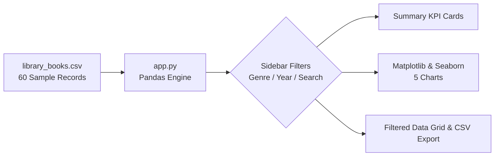

<div align="center">

# 📚 Library Book Analysis & Data Visualization System
### *An Interactive Academic Data Analytics & Dashboard Mini-Project*

[](https://www.python.org/)
[](https://streamlit.io/)
[](https://pandas.pydata.org/)
[](https://matplotlib.org/)
[](https://seaborn.pydata.org/)
[](#)

<p align="center">
  <b>A lightweight, zero-database, beginner-friendly data analytics dashboard designed for college project presentations, practical exams, and viva voce.</b>
</p>

[✨ Key Features](#-key-features) •
[📊 Visualizations](#-visualizations-breakdown) •
[📁 Project Structure](#-project-structure) •
[🚀 Quick Start](#-quick-start-guide) •
[🎓 College Viva Q&A](#-college-viva--exam-qa) •
[🛠️ Troubleshooting](#-troubleshooting)

---

</div>

## 📖 Table of Contents
1. [Project Overview](#-project-overview)
2. [Key Features](#-key-features)
3. [Architecture & Workflow](#-architecture--workflow)
4. [Dataset Specifications](#-dataset-specifications)
5. [Visualizations Breakdown](#-visualizations-breakdown)
6. [Project Structure](#-project-structure)
7. [Quick Start Guide (Windows / macOS / Linux)](#-quick-start-guide)
8. [College Viva & Presentation Guide](#-college-viva--exam-qa)
9. [Troubleshooting](#-troubleshooting)

---

## 🎯 Project Overview

Libraries maintain hundreds of volumes across varied subjects. Effective library administration requires understanding book circulation, inventory allocation, and patron preferences.

This project delivers a **streamlined, self-contained Data Analytics Dashboard**:
- **Zero Complex Setup**: Requires no SQL databases, no Docker, and no backend servers.
- **Fast & Interactive**: Powered by Streamlit with instant filtering and dynamic visual feedback.
- **Academic Focus**: Built specifically to help students demonstrate data manipulation (`Pandas`), exploratory analysis, and charting (`Matplotlib`, `Seaborn`).

---

## ✨ Key Features

| Category | Features & Functionality |
| :--- | :--- |
| **📈 Live KPI Cards** | Total unique titles, total shelf copies, cumulative checkouts, average ratings, leading genre, top borrowed title, and publication year range. |
| **🔍 Interactive Filters** | Sidebar multi-select for genres, slider for publication years, and real-time search box for Book Titles and Authors. |
| **📊 5 Modern Charts** | Color-coded bar charts, percentage pie chart, timeline trend curve, and horizontal ranking charts with direct data labels. |
| **📋 Data Explorer** | Clean, sortable data grid showing all filtered columns with instant CSV export capability. |
| **🛡️ Fail-Safe Handling** | Graceful empty-state warnings when filters match zero records, preventing runtime crashes. |
| **💡 Analytical Insights** | Dedicated section with ready-to-speak findings tailored for presentation examiners. |

---

## 🏗️ Architecture & Workflow



1. **Data Ingestion**: Pandas reads `library_books.csv` with fallback auto-generation if the file is moved.
2. **Data Sanitization**: Validates data types, strips whitespace, and removes nulls.
3. **Filtering**: Slices records dynamically based on user selections in the Streamlit sidebar.
4. **Rendering**: Updates summary metrics, redraws the 5 charts, and refreshes the table simultaneously.

---

## 📂 Project Structure

```text
library_book_analysis/
│
├── app.py               # Streamlit application with dashboard UI & analytics logic
├── library_books.csv    # 60 sample records across 7 genres (realistic academic data)
├── requirements.txt     # Python package dependencies
└── README.md            # Comprehensive project documentation
```

---

## 📄 Dataset Specifications (`library_books.csv`)

The dataset comprises **60 realistic sample records** across 7 genres: `Fiction`, `Science`, `Technology`, `History`, `Mystery`, `Fantasy`, and `Biography`.

| Column | Type | Example | Description |
| :--- | :--- | :--- | :--- |
| `Book_ID` | `int` | `1001` | Unique numerical identification key |
| `Book_Title` | `string` | `To Kill a Mockingbird` | Full title of the publication |
| `Author` | `string` | `Harper Lee` | Primary author name |
| `Genre` | `string` | `Fiction` | Broad subject classification |
| `Publication_Year` | `int` | `1960` | Year of publication (ranges 1813 to 2022) |
| `Copies_Available` | `int` | `8` | Number of physical copies in inventory |
| `Times_Borrowed` | `int` | `142` | Cumulative checkout counter |
| `Rating` | `float` | `4.8` | Average reader score (out of 5.0) |

> **Note**: This dataset is synthetic and marked as sample data for academic demonstration.

---

## 📊 Visualizations Breakdown

The system generates 5 distinct, professionally labeled plots:

```
┌──────────────────────────────────────┬──────────────────────────────────────┐
│  1. Books per Genre (Bar Chart)      │  2. Genre Distribution (Pie Chart)   │
│  Counts books across classifications │  Percentage share of each category   │
├──────────────────────────────────────┼──────────────────────────────────────┤
│  3. Top 10 Borrowed Books (Barh)     │  4. Average Rating by Genre (Bar)    │
│  Rankings of most popular titles     │  Quality comparison across subjects  │
├──────────────────────────────────────┴──────────────────────────────────────┤
│  5. Publication Trend Over Time (Line Chart with Shaded Area)               │
│  Evolution of library acquisitions across publication years                │
└─────────────────────────────────────────────────────────────────────────────┘
```

1. **Number of Books in Each Genre**:
   - Compares catalogue diversity. Value labels above each bar show exact book counts.
2. **Top 10 Most Borrowed Books**:
   - Horizontal bar chart identifying highest demand titles for inventory decisions.
3. **Distribution of Books by Genre**:
   - Formatted pie chart highlighting percentage representation with clean segment borders.
4. **Publication Trend Over Time**:
   - Area line chart tracing publication release years from historical volumes to contemporary works.
5. **Average Ratings of Different Genres**:
   - Star-annotated vertical bars comparing perceived quality across genres (e.g., `4.80★`).

---

## 🚀 Quick Start Guide

### Prerequisites
- Python 3.10+ installed on your machine.
- Verify installation by opening terminal/PowerShell and running:
  ```bash
  python --version
  ```

---

### Windows (PowerShell / Command Prompt)

1. **Navigate to the project folder:**
   ```powershell
   cd c:\Users\kothu\OneDrive\Desktop\jas\library_book_analysis
   ```

2. **(Recommended) Create & activate a virtual environment:**
   ```powershell
   python -m venv venv
   .\venv\Scripts\Activate.ps1
   ```
   *(If script execution is blocked on PowerShell, run `Set-ExecutionPolicy -Scope Process -ExecutionPolicy Bypass` first, or use CMD).*

3. **Install the dependencies:**
   ```powershell
   python -m pip install -r requirements.txt
   ```

4. **Launch the dashboard:**
   ```powershell
   python -m streamlit run app.py
   ```

---

### macOS / Linux

1. **Navigate and create virtual environment:**
   ```bash
   cd library_book_analysis
   python3 -m venv venv
   source venv/bin/activate
   ```

2. **Install dependencies and run:**
   ```bash
   pip install -r requirements.txt
   streamlit run app.py
   ```

---

## 🌐 Accessing the Web Dashboard

Once launched, Streamlit will print:
```text
  You can now view your Streamlit app in your browser.

  Local URL: http://localhost:8501
  Network URL: http://192.168.x.x:8501
```
Open **`http://localhost:8501`** in Google Chrome, Microsoft Edge, or any modern web browser.

---

## 🎓 College Viva & Exam Q&A

Use these concise questions and answers to excel during your college project viva:

<details>
<summary><b>Q1: Why did you choose Streamlit instead of Flask or Django?</b></summary>
<br/>
<b>Answer:</b> Streamlit is tailored specifically for rapid data science and analytics prototypes. Unlike Flask or Django, which require HTML templates, CSS stylesheets, JavaScript routing, and form handling, Streamlit automatically turns Python data scripts into a reactive web interface with minimal boilerplate.
</details>

<details>
<summary><b>Q2: How does the application handle data filtering dynamically?</b></summary>
<br/>
<b>Answer:</b> Streamlit uses a reactive execution model. Whenever a user interacts with a sidebar filter (e.g., selecting a genre or moving the year slider), Streamlit reruns the script from top to bottom. Pandas filters the DataFrame using conditional boolean indexing, and the figures are re-plotted with the filtered subset.
</details>

<details>
<summary><b>Q3: How does the system prevent crashes when filters match zero records?</b></summary>
<br/>
<b>Answer:</b> In <code>app.py</code>, we verify <code>if not filtered_df.empty:</code> before executing calculations and drawing charts. If the filtered DataFrame is empty, a clean <code>st.warning()</code> notice is displayed to the user instead of letting plotting libraries throw index or division-by-zero errors.
</details>

<details>
<summary><b>Q4: What is the benefit of caching with `@st.cache_data`?</b></summary>
<br/>
<b>Answer:</b> <code>@st.cache_data</code> stores the parsed CSV dataset in memory after the initial read. Subsequent filter interactions and re-runs do not re-read the CSV from disk, significantly improving application speed and reducing disk I/O.
</details>

<details>
<summary><b>Q5: What are the primary data insights discovered in this dataset?</b></summary>
<br/>
<b>Answer:</b>
1. <b>Fantasy and Fiction</b> account for the highest borrowing numbers (*Harry Potter*, *The Hobbit*, *1984*).
2. The library collection has modern additions in <b>Technology & Science</b> concentrated between 2000 and 2022.
3. Average reader ratings across all genres remain high and stable (between 4.4 and 4.8 out of 5.0).
</details>

---

## 🛠️ Troubleshooting

| Issue / Error | Probable Cause | Quick Fix |
| :--- | :--- | :--- |
| `'streamlit' is not recognized` | Streamlit binary path not in Windows PATH | Run using Python module syntax: `python -m streamlit run app.py` |
| `ExecutionPolicy` error in PowerShell | Windows script restriction | Run `Set-ExecutionPolicy -Scope Process -ExecutionPolicy Bypass` in PowerShell before activating `venv`. |
| `Port 8501 already in use` | Another instance is already running | Run on a different port: `python -m streamlit run app.py --server.port 8502` |
| ModuleNotFoundError: `pandas` / `seaborn` | Packages not installed in active environment | Run `python -m pip install -r requirements.txt` |

---

<div align="center">

Developed with ❤️ for Academic Learning & College Project Presentations

</div>
